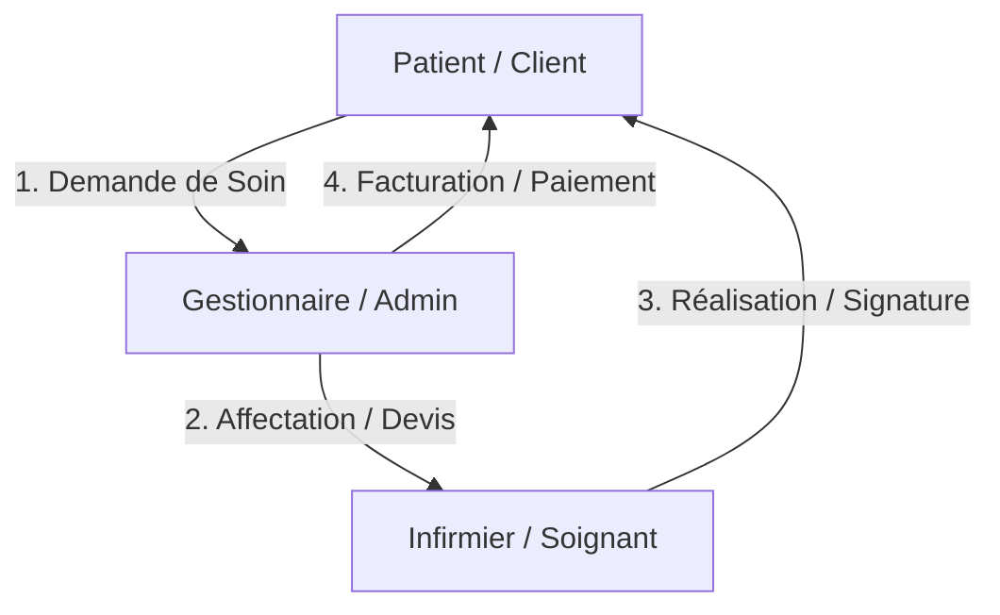

# 📝 Plan Projet, Technique & Code - Dar-Soins

Ce document détaille l'organisation globale du projet **Dar-Soins**, son architecture technique et sa structure de code. Il sert de guide de référence pour l'équipe de développement et les parties prenantes.

---

## 📅 1. Le Plan Projet

**Dar-Soins** est une plateforme SaaS de mise en relation et de gestion de soins de santé à domicile. Elle permet de connecter des patients (clients) avec des professionnels de santé (infirmiers) sous la supervision d'un gestionnaire (administrateur).



### 🛣️ Feuilles de Route & Jalons
Le projet est divisé en plusieurs phases clés :

| Phase | Description | Statut |
| :--- | :--- | :--- |
| **Phase 1 : Fondations** | Initialisation de la base de données, modèles de données et authentification multi-rôles. |  Complété |
| **Phase 2 : Modernisation UI/UX** | Refonte complète de la charte graphique (Glassmorphism, animations, adaptabilité mobile). |  Complété |
| **Phase 3 : Dashboards Spécifiques** | Amélioration des interfaces Patient, Infirmier et Administrateur (Option 1). |  Complété |
| **Phase 4 : Workflow d'Intervention** | Cycle complet : Demande $\rightarrow$ Affectation $\rightarrow$ Devis $\rightarrow$ Réalisation $\rightarrow$ Signature. |  À venir |
| **Phase 5 : Modules ERP** | Gestion de la facturation avancée, achats, fournisseurs et inventaire. |  À venir |

---

## 💻 2. Le Plan Technique

### 🏗️ Architecture Globale
L'application repose sur un découpage strict **Frontend (Client SPA)** et **Backend (API RESTful)**.

```
┌─────────────────────────────────┐        HTTP (JSON)        ┌─────────────────────────────────┐
│     Frontend (React / Vite)     │ ────────────────────────> │       Backend (Laravel 11)      │
│  Tailwind CSS & Lucide Icons    │ <──────────────────────── │    Eloquent ORM & Sanctum Auth  │
└─────────────────────────────────┘                           └─────────────────────────────────┘
                                                                               │
                                                                               ▼
                                                              ┌─────────────────────────────────┐
                                                              │       Base de Données SQL       │
                                                              └─────────────────────────────────┘
```

### 🛠️ Choix Technologiques

#### Frontend (React / Vite)
*   **Vite** : Outil de build ultra-rapide pour le développement local.
*   **React SPA** : Navigation instantanée sans rechargement de page via `react-router-dom`.
*   **Tailwind CSS** : Utilisé pour implémenter un système de design harmonieux et réactif.
*   **Axios** : Client HTTP configuré avec des intercepteurs pour insérer automatiquement le jeton JWT/Sanctum dans les en-têtes de requêtes.
*   **Lucide React** : Ensemble d'icônes vectorielles modernes et légères.

#### Backend (Laravel 11)
*   **Laravel Framework** : Structure Robuste, sécurisée et extensible.
*   **Laravel Sanctum** : Système d'authentification par jetons API légers, idéal pour les applications SPA.
*   **Eloquent ORM** : Pour la manipulation simplifiée et sécurisée de la base de données relationnelle.
*   **Middlewares Personnalisés** : Filtrage des requêtes par rôle utilisateur (`client`, `infirmier`, `gestionnaire`) afin de sécuriser l'accès aux données.

---

## 📂 3. Le Plan de Code

### 📁 Structure des Dossiers du Projet

```
dar-soins/
├── backend/                  # API Laravel
│   ├── app/
│   │   ├── Http/
│   │   │   ├── Controllers/  # Contrôleurs API (AuthController, PersonnelController...)
│   │   │   └── Middleware/   # Middlewares de vérification des rôles
│   │   └── Models/           # Modèles Eloquent (User, Infirmier, Produit, Facture)
│   ├── database/             # Migrations et Seeders
│   └── routes/
│       └── api.php           # Définition des routes de l'API REST
│
├── frontend/                 # Application Single Page React
│   ├── src/
│   │   ├── components/       # Composants partagés (Navbar, Footer, ProtectedRoute...)
│   │   ├── pages/            # Vues principales (Home, ClientDashboard, AdminDashboard...)
│   │   ├── services/         # Configuration API (api.js avec interceptor Axios)
│   │   ├── index.css         # Design system CSS avec variables Tailwind
│   │   └── App.jsx           # Déclaration des routes react-router-dom
│   └── package.json
│
└── walkthrough/              # Documentation technique et guides du projet
```

### 🔑 Concepts Clés d'Implémentation du Code

#### 1. Système de Design Centralisé (`index.css`)
Au lieu d'écrire des styles ad-hoc, nous utilisons des variables CSS et des utilitaires Tailwind personnalisés :
```css
:root {
  --primary-color: #2563EB;
  --bg-app: #F8FAFC;
  --card-bg: #FFFFFF;
  /* ... */
}
```
Ceci permet de basculer facilement d'un thème clair (site public) à un thème sombre (ERP Administrateur) en changeant simplement les classes du conteneur parent.

#### 2. Sécurisation des Routes Frontend (`ProtectedRoute.jsx`)
Les pages privées sont encapsulées dans un composant de garde qui vérifie le rôle de l'utilisateur connecté dans le state local / localStorage :
```javascript
export default function ProtectedRoute({ children, allowedRoles }) {
  const user = JSON.parse(localStorage.getItem('user'));
  if (!user) return <Navigate to="/login" replace />;
  if (allowedRoles && !allowedRoles.includes(user.role)) {
    return <Navigate to="/" replace />;
  }
  return children;
}
```

#### 3. Eager Loading Backend Optimisé
Pour éviter le problème classique des requêtes N+1 de base de données sans surcharger les réponses JSON, nous chargeons uniquement les relations existantes et nécessaires.
*Exemple (correction effectuée)* :
```php
// Correct
return response()->json(Infirmier::with('user')->get());
```
*(L'appel à la relation fictive `localisation` a été supprimé car les coordonnées GPS sont directement stockées dans la table des infirmiers).*
